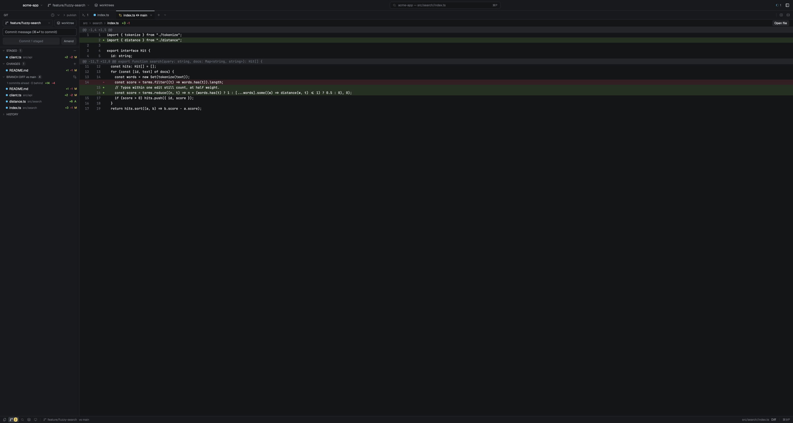

# herdr-ide

A Zed-style IDE layout for [Herdr](https://herdr.dev): one tab strip for terminals, agents **and** files; a file tree that never follows `cd`; and git first, with a branch diff, history and worktree switching that stays in your space.



## Features

- **One tab strip.** Files open as Herdr tabs beside your terminal and agent tabs. Split a file next to Claude, and use ⌘W / ctrl-tab / ⌘1–9 the same way everywhere.
- **Fixed project folder per space.** The Explorer, Search, Git and Go to file stay put when you `cd`.
- **Editor pane:**
  - Save with conflict detection, drafts that survive restarts, and live reload while an agent edits.
  - Markdown preview, CSV as a table, images.
  - PDFs as pages, re-rendered on change (nice for LaTeX), and Quick Look for Office files.
- **Git panel:**
  - Stage, unstage, discard, commit and amend.
  - Fetch, pull and push.
  - **Branch diff vs a base branch.**
  - History with per-commit files.
  - Every diff opens as a tab.
- **Branch picker** to switch, create, or compare against a branch.
- **Worktree picker** to switch, create or remove worktrees. It re-roots the IDE, not your space.
- **Search in files** (ripgrep), **Go to file** (⌘P), and ⌘-click on `path:line` in any terminal.

## Install

Requires Herdr (macOS is the tested platform). Optional tools: `rg`, and `pdftoppm` from poppler (`brew install ripgrep poppler`).

```sh
git clone https://github.com/shanto462/herdr-ide /tmp/herdr-ide
H=~/.config/herdr-app
# Move each mod in whole: a folder that appears without its mod.json gets auto-docked.
mkdir -p "$H/mods-incoming"
for m in /tmp/herdr-ide/mods/ide-*; do
  cp -R "$m" "$H/mods-incoming/" && mv "$H/mods-incoming/$(basename "$m")" "$H/mods/"
done
rmdir "$H/mods-incoming"
cp /tmp/herdr-ide/layouts/ide.json /tmp/herdr-ide/layouts/ide.svg "$H/layouts/"
for m in "$H"/mods/ide-*; do herdr-app check "$m"; done
herdr-app do layout.switch '{"name":"ide"}'
```

Then add the `layout:ide` section from [`keys.json`](keys.json) to your `~/.config/herdr-app/keys.json` (⌘P, ⌘S, ⌘⇧E/G/F). `ctrl-shift-l` cycles layouts, so your current one is one key away.

**Your launchers:** edit `mods/ide-tabs/config.js` to add buttons that start your agents (e.g. `claude`, `codex`) as named tabs. Keep that file when you update.

## Notes

- Mods can't import each other, so every mod carries the same `common.js`.
- The layout uses Herdr's shipped `spaces`, `agents` and `pane` mods.
- [`RECIPE.md`](RECIPE.md) is the full brief, detailed enough to rebuild it from scratch.

## License

MIT
