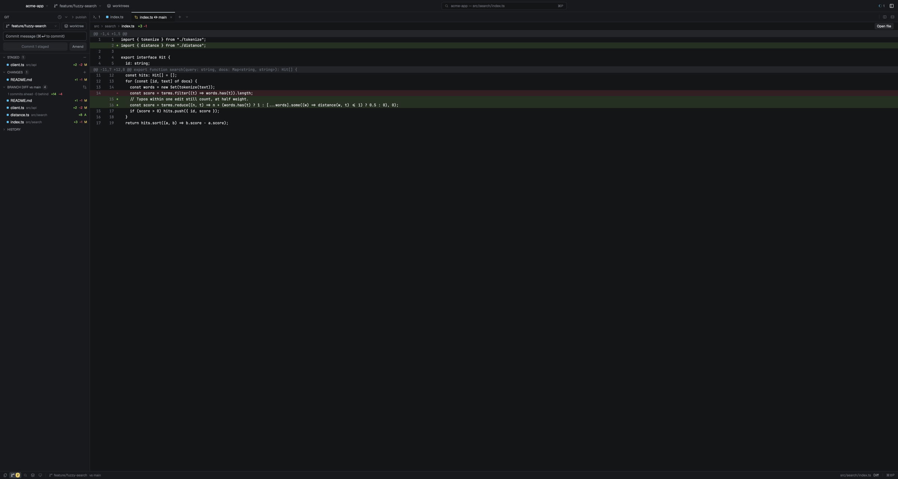

# IDE

A Zed-style IDE for Herdr, built for people who mostly drive coding agents in terminals and then read, edit and review what they changed. Files open as ordinary Herdr tabs next to your terminal and agent tabs, so there is one tab strip and no screen split between "editor" and "terminal". The file tree has a fixed project folder per space and never follows `cd`. Git comes first: staging, commits, push/pull, a branch diff against a base branch, history, and a worktree switcher that re-roots the IDE without switching spaces.

## What you see

Top to bottom:

- **Title bar (40px, chrome, draggable).** Room for the macOS traffic lights (78px), then three chips: the project name ▾ (opens the Spaces view), `⎇ branch ↑ahead ↓behind ▾` (branch picker) and `worktrees` (worktree picker). In the middle is a 420px command field showing `project — relative/path` of the shown file; it opens Go to file. On the right: agent counts (spinner for working, colored dots for blocked/done) and a left-dock toggle.
- **Body row.**
  - **Left dock (300px, 200–720, chrome).** A stack with one view at a time: Explorer, Git, Search, Spaces (Herdr's `spaces`) and Agents (Herdr's `agents`).
  - **Center.** A 34px tab strip over the shown tab's panes.
    - Tabs are underlined in the accent color when active. Terminal and agent tabs show the program icon and a status mark: a spinner while working, a dot for blocked/done.
    - File tabs show a small colored square per file type, a compare icon for diffs, *italic* text for a preview tab, and a dot while unsaved.
    - Right of the tabs: `+` (new terminal in the project folder), `▾` (Herdr's new menu), your launchers from `config.js`, then split right / split down.
- **Status bar (26px).** Left: buttons for the dock views (Git shows a change count, Agents a blocked count), the branch with ↑/↓ and the base it's compared against. Right: the shown file's path, an "unsaved" mark and its language, then `⌘⇧P`.

## How it behaves

- **Agents:**
  - Working agents show a spinner on their tab and in the title bar.
  - Blocked or done agents show a dot in the `blocked` / `done` color.
  - Idle agents show nothing.
- **Opening files:**
  - Clicking a file in the Explorer, Search or Git opens a preview tab, which the next single-clicked file replaces. Double-clicking, or editing the file, pins the tab.
  - An already-open file just gets its tab selected.
  - File tabs always go after every other tab, so ⌘1–n keep meaning your launcher tabs.
- **Editor pane:**
  - Syntax highlighting, line numbers, and ⌘S to save.
  - Saving is refused if the file changed on disk since it was loaded, and a banner offers "Use disk version" or "Keep mine".
  - A clean editor reloads by itself when the file changes on disk (an agent editing it).
  - Unsaved edits are kept as drafts under `data/ide-drafts`, so closing the tab or Herdr loses nothing.
  - Markdown has an Edit/Preview toggle, and CSV/TSV show as a table.
  - Images show inline. PDFs render every page (`pdftoppm`) and re-render when the PDF changes. Office and Keynote files get a Quick Look thumbnail, and non-UTF-8 text is shown read-only.
- **Hunks:** a working-changes diff tab has an Unstaged / Staged switch and Stage file / Unstage file buttons. Each `@@` header has Stage hunk and Discard (unstaged side), or Unstage hunk (staged side). Branch and agent-turn diffs have Revert hunk. Discard and revert need a second click to confirm. A hunk is applied as a one-hunk patch (the file's diff header plus that hunk) with `git apply [--cached] [-R]` at the repo top. Diffs over 2,500 lines, or with lines cut at 2,000 characters, show no hunk actions.
- **Find / replace (⌘F, ⌥⌘F in an editor):** a bar under the breadcrumb with the match count, ↑/↓, Enter and ⇧Enter, match case / whole word / regex (with `$1` groups), Replace, and Replace all as one undo step. The current match is shown by selecting it.
- **Diff tabs:** working tree vs HEAD, vs the merge-base with a base branch (`name ↔ main`), or one commit (`name @abc1234`).
- **Explorer:**
  - Git marks on files and folders; ignored files are dimmed.
  - The file shown in the editor is highlighted and revealed in the tree.
  - Right-click for new / rename / duplicate / cut / copy / paste / trash / copy path / reveal / open terminal / set as project root / send to an agent.
  - Drag a file onto a terminal to paste its path.
- **Project folder:** chosen once per space (the repo of its first terminal, else that folder). Change it by clicking the project row, or with "Set as project root".
- **Git panel:**
  - Branch and worktree pickers.
  - Fetch / pull (fast-forward only) / push, publishing the branch when it has no upstream.
  - A commit box (commits what's staged, else everything) and Amend.
  - Staged and changed files with stage, unstage, discard and open buttons.
  - BRANCH DIFF vs a base you pick (default: origin's HEAD, else main/master), with ahead/behind counts.
  - History, where you can expand a commit to see its files.
- **Branch picker:**
  - Type to filter; Enter switches.
  - Typing a new name offers "Create branch".
  - "compare" sets the branch-diff base.
  - A branch checked out in another worktree opens that worktree instead.
- **Worktree picker:**
  - Lists worktrees with their changed-file count.
  - Clicking one re-roots Explorer, Git, Search and Go to file. It stays in the space and leaves terminals alone.
  - The input creates a worktree (new or existing branch) at `worktrees.directory/<repo>/<branch>`.
  - Remove asks for a second click to confirm.
- **Home tab:** every space keeps one; it is last in tab order and drawn as a home icon at the left of the strip. It shows the project and branch, quick actions, launchers, agents in the space, recent agent changes and recent files. Because it always exists, closing every other tab keeps the space. ⌘N and the Spaces "+" open a folder as a space with only Home.
- **Agent turns:** when an agent goes `working`, the working tree is snapshotted into a throwaway index (`git add -A` into a copy of the index, then `git write-tree`; the real index is untouched). When it stops, a second snapshot is diffed against the first. Turns that changed files appear in the Git panel's AGENT TURNS section (agent, tab, files, +/−). Clicking a file opens a `turn:<before>..<after>` diff. You can revert a single file, or the whole turn with a second click to confirm. A toast also reports the change count.
- **Command palette (⌘⇧P):** the IDE's commands with their keys, filtered as you type. Go to line is `⌃G` in an editor, or `:42` in Go to file.
- **Search (⌘⇧F):** ripgrep (git grep as fallback) with match case / whole word / regex / include globs; results grouped by file; a click opens the file at the line.
- **Keys** (`layout:ide`): ⌘P go to file, ⌘S save, ⌘⇧E / ⌘⇧G / ⌘⇧F switch the dock view (pressing it again hides the dock), ⌘B toggles the dock, and ⌘-click on `path:line` in a terminal opens it at that line.

## Built from

- Layout tree: root `column` [`titlebar` block (`ide-titlebar`, `window_drag`), `body` row [`sidebar` stack (`view-explorer` `ide-explorer`, `view-git` `ide-git`, `view-search` `ide-find`, `view-spaces` `spaces`, `view-agents` `agents`), `center` column [`tabs` block (`ide-tabs`), `terminals` block (`tab: "active"`, pane frames with the shipped `pane` header, `lone: false`)]], `status` block (`ide-status`)]. Root: `titlebar: "none"`, `traffic_lights: [14, 14]`, `link_handlers: ["ide-editor"]`.
- Mods: `ide-home` (Home tab), `ide-commands` (palette), `ide-tabs` (strip, file-tab registry, opens files, Home keeper, agent-turn snapshots), `ide-editor` (one file or diff per pane; `link.js` terminal link handler), `ide-editor-menu`, `ide-explorer` (with `icons/`), `ide-fileops` (file actions; `ops.js`), `ide-find`, `ide-quickopen`, `ide-git`, `ide-branches`, `ide-worktrees`, `ide-titlebar`, `ide-status`. Each has an identical `common.js` (mods can't import each other).
- Shared state: `ide.turns`, `ide.recent`, `ide.cursor`, `ide.launchers`/`ide.launch`, `ide.roots` {space: {path, on}}, `ide.open` (open requests), `ide.filetabs` {uid: {tab, space, kind, path, ref, preview}}, `ide.active`, `ide.dirty`, `ide.goto`, `ide.fs` (moves/deletes), `ide.scm`, `ide.git.base`.
- Herdr API: `tab.new {mod, props}` via `herdr-app do` (to learn the tab id), `tab.select/move/close/rename`, `layout.select/show/hide/toggle`, `pane.split`, `space.select`, `watchFolder`, `readTextFile`, `writeTextFile(path, text, expected)`, `exec`, `drag_paths`, `EditorState`/`Editor`, `TextView.markdown`, `v_virtual_list`, `openOverlay`, `pickFolder`.
- Programs: `git`; optional `rg`, `pdftoppm`/`pdfinfo` (poppler), and on macOS `sips`, `qlmanage`, `file`, `iconv`, `open`.
- Shipped icons from `mods/workspace-chrome`, `mods/files`, `mods/pane`, plus Lucide-style icons in `mods/ide-explorer/icons`.

## Watch out

- Install each mod folder with its `mod.json` already in it (copy to a temp dir, then `mv`). A folder that appears with `main.js` first gets auto-docked into whatever layout is shown.
- Work started from `render()` never runs: everything that opens or loads goes through timers (120–300ms) that compare shared values.
- `image()` only loads from under the Herdr home, so previews are copied or rendered to `data/ide-preview/<hash>-<mtime>.*` and old renders are removed.
- `mod.open` toggles; `<mod>.<command>` keys reach only shown copies.
- File tabs are found again through `ide.filetabs`; stale entries are dropped once their tab is gone.
- Diffs of very large files are cut to 6,000 lines, editors to 400k characters (read-only beyond), and the tree to 1,000 entries per folder.
- Remote spaces: files open read-only, previews and folder watching are local-only, and git runs on the space's machine.

## Done when

- `herdr-app check` passes for every `mods/ide-*`, and `layout.switch {name: "ide"}` shows the title bar, dock, one tab strip and status bar.
- `cd` in a terminal does not change the Explorer's root; "Set as project root" does.
- Clicking files opens preview tabs placed after every other tab; ⌘S saves; editing a file elsewhere updates a clean editor.
- In a repo with a feature branch: the Git panel matches `git status`, stage/commit/push work, BRANCH DIFF lists the branch's files, and a diff tab opens for each.
- Creating a worktree from the picker re-roots the IDE while the space id stays the same; picking a branch that lives in another worktree jumps there.
